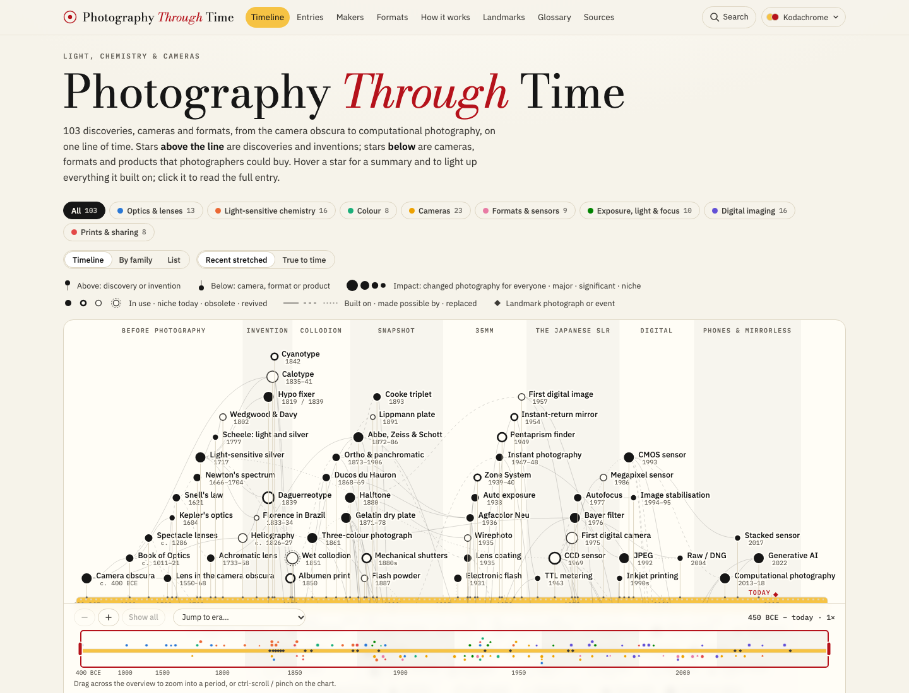

# Photography Through Time

An interactive history of photography, from the camera obscura to computational photography: one
star-chart timeline of the discoveries, processes, cameras, formats and companies that made the
medium, with a page for each and primers on the physics behind them.

**Live site:** [ptt.sconetto.me](https://ptt.sconetto.me) (coming soon)



## What's inside

- **Timeline.** Every entry is a star on one line of time. Stars above the band are discoveries and
  inventions; stars below are cameras, formats and products. Star size shows impact, fill shows
  whether it is still in use, and lines show what built on what. Hover a star for a summary and its
  lineage; click it to open the full entry. Zoom into any period from the overview strip under the
  chart (drag across it, or pick an era), with ctrl-scroll or pinch, or with the + and − keys; the
  overview always shows which part of the timeline is in view. There are also by-family lanes and a
  list view.
- **Entries.** Each entry tells how it began, how it works, why it mattered and what replaced it, with
  key dates, people, specs, the frame drawn to scale and sources.
- **Makers.** A lifespan chart of camera and film companies by country, with the mergers, takeovers and
  sales that link them (Minolta → Konica Minolta → Sony, Pentax → Hoya → Ricoh and more).
- **Formats.** Film and sensor sizes from 8×10 inch to phone sensors, overlaid to scale, with a crop
  factor and equivalent focal length calculator.
- **How it works.** Nine primers on the physics and chemistry of photography, from the pinhole to
  computational photography, each with an interactive diagram: angle of view, depth of field, the
  exposure triangle, colour mixing and white balance, a Bayer sensor, burst stacking and more.
- **Landmarks, glossary and search.** Turning points in photography, a glossary of terms used across
  the site, and full-text search.

Four colour palettes (Kodachrome, Print & Darkroom, Cyanotype, Platinum & Selenium), each in day and
night modes.

## Status

Work in progress. The timeline, entries, makers, formats, physics primers, landmarks, glossary and
search are in place, with 103 entries, 35 makers and nine primers, public-domain photographs on the
landmarks and 24 entries, and camera silhouettes. Still to come: a fact-check pass, and launch.

## Development

Requires Node 26 (see `.nvmrc`) and [pnpm](https://pnpm.io).

```sh
pnpm install
pnpm dev        # local dev server
pnpm build      # static build into dist/, plus the Pagefind search index
pnpm preview    # serve the build at http://localhost:4321
pnpm check      # type check
pnpm test       # unit tests (Vitest)
pnpm e2e        # end-to-end and accessibility tests (Playwright + axe, against pnpm preview)
pnpm links      # check every external link in the content
```

Built with [Astro](https://astro.build), TypeScript, MDX and [Pagefind](https://pagefind.app), with
no client-side UI framework.

## Content

All content lives in `src/content/`:

| Path | What it holds |
|---|---|
| `entries/*.mdx` | One file per timeline entry: frontmatter for dates, family, impact, lineage and specs, and an MDX body with the narrative sections |
| `makers/*.md` | Companies, with founding and end dates and lineage links |
| `physics/*.mdx` | The "How it works" primers |
| `*.yaml` | Eras, families, formats, glossary, landmarks and general sources |

The build refuses bad data. It fails on an unknown reference, a child dated before its parent, a
missing narrative section, an image without credit and licence, a broken `[[wikilink]]`, or a link to
a blocklisted domain. Inside text, `[[id]]` links an entry, `[[m:id]]` a maker, `[[p:id]]` a primer and
`[[g:term]]` a glossary term.

### Sources

Entries cite their sources on each page; general references are on the Sources page. Text is written
fresh and paraphrased from those sources, never copied. Copyrighted books are used for fact-checking
and cited paraphrase only, and are kept out of the repository in the git-ignored `references/` folder.
Images are public domain (or CC0), each credited with its source. `node scripts/commons.ts` searches
Wikimedia Commons, refuses any file that is not public domain, and saves a scaled copy with its
credit. Cameras are drawn as original SVG silhouettes, not photographed.

## Contributing

Corrections and additions are welcome: open an issue or a pull request. Commits follow
[Conventional Commits](https://www.conventionalcommits.org/) (`type(scope): short description`, with
a bulleted body and a `Signed-off-by` line). Please run `pnpm check`, `pnpm test` and `pnpm build`
before opening a pull request.

## Acknowledgements

Inspired by the star-chart design of *Politics Through Time*
([petrogko/politics-history-timeline](https://github.com/petrogko/politics-history-timeline)). This
project shares its ideas but none of its code.

## License

Copyright © 2026 João Pedro Sconetto.

This project is free software: you can redistribute it and/or modify it under the terms of the
[GNU General Public License](LICENSE) as published by the Free Software Foundation, either version 3
of the License, or (at your option) any later version.

It is distributed in the hope that it will be useful, but WITHOUT ANY WARRANTY; without even the
implied warranty of MERCHANTABILITY or FITNESS FOR A PARTICULAR PURPOSE. See the [LICENSE](LICENSE)
file for details.

Public-domain images keep their public-domain status. Company and product names are trademarks of
their owners and are used only to describe their history.
